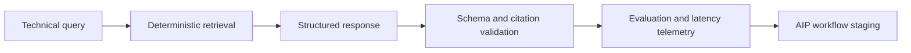

# Grounded technical retrieval evaluation

Deterministic retrieval over generated Space Coast engineering notes, with structured
responses, citation validation, abstention handling and latency measurement.

Install `python -m pip install -r requirements.txt`.
Run `python -m src.retriever` and `python -m unittest discover -s tests`.
The harness emits JSON with citations, abstentions and p50/p95 latency under `artifacts/`.
Retrieval uses document-frequency-weighted token overlap with deterministic tie breaks.
Answers quote exact source sentences; citation validation checks document identity and
verbatim support. Unknown queries abstain. This implements a retrieval baseline and
evaluation boundary; no language model or live Foundry enrollment is connected.
`dashboard/status_view.ts` provides a typed status renderer with escaped content.
